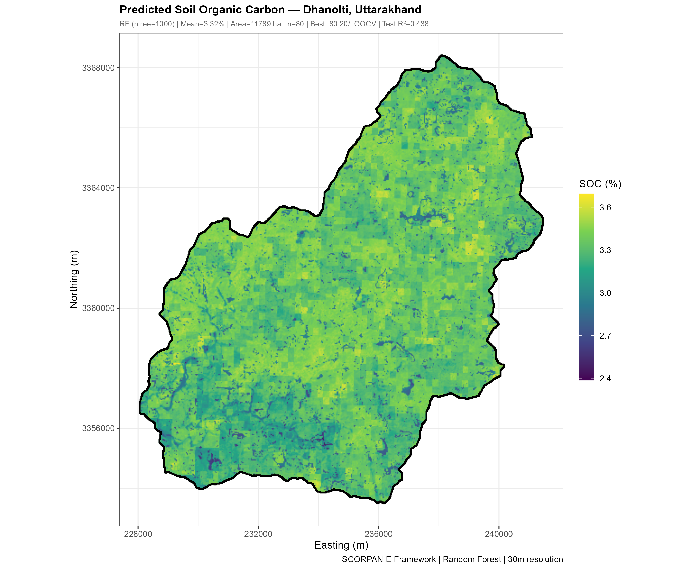

<div align="center">

# 🏔️ Soil Organic Carbon Mapping — Dhanolti, Uttarakhand

**How much organic carbon do the topsoils of a Himalayan watershed hold, and where?**
Digital soil mapping at 30 m with Random Forest on 27 Earth Engine covariates, structured on the SCORPAN-E framework.

[](SOC_Map.png)
[](SOC_MASTER.R)




</div>

---

## 📊 Key results

| | Result |
|---|---|
| 🤖 **Random Forest, best test R²** | **0.44** (random k-fold — see caveat below) |
| ✂️ Splits tested | 70:30 and 80:20 |
| 🔁 Cross-validation | 5-fold, 10-fold, LOOCV |
| 🌲 Final model | 1,000 trees |
| 🗺️ Resolution | 30 m |
| 🧭 Framework | SCORPAN-E, 27 covariates |

> ⚠️ **Validation caveat.** All cross-validation here is random-fold. Soil properties are spatially autocorrelated, so random folds put neighbouring samples in both training and test sets, and the score is optimistic. Reporting the best result across several split ratios adds more optimism. Spatially blocked re-validation is pending, and the honest expectation is a figure below 0.44. The spatial block cross-validation used in the [Ludhiana carbon stock project](https://github.com/sathwikramaka/carbon-stock-estimation-ludhiana) is the approach that should have been used here.

## 🔍 What it does

- **Covariates from Earth Engine** — terrain, climate, vegetation dynamics, hydrology, lithology, land use and soil properties for every pixel.
- **Feature selection by importance** — Random Forest %IncMSE ranks predictors before the final model.
- **Uncertainty as a map** — the spread across 1,000 trees is exported as its own raster next to the prediction.
- **Zones for decisions** — the continuous map is also classified into five SOC zones.
- **One script, six sections** — `SOC_MASTER.R` runs cleaning → selection → training → model choice → prediction → maps, and installs its own packages.

## 🛰️ Covariates

| Category | Variables |
|----------|-----------|
| **Terrain** | Slope, TWI, Elevation, Aspect, Plan Curvature, Profile Curvature |
| **Climate** | Mean Annual Temperature, Mean Annual Precipitation, Precipitation Seasonality |
| **Vegetation** | NDVI, EVI, NDWI, SAVI, NDVI Slope, NDVI Intercept, NDVI Max, Monsoon NDVI Slope, Winter NDVI Slope |
| **Hydrology** | Distance to Stream |
| **Land** | Lithology, LULC |
| **Soil Properties** | pH, Sand %, Clay %, Silt %, Nitrogen (g/kg), Bulk Density (kg/dm³) |

## 🚀 Run it yourself

Edit the two lines at the top of `SOC_MASTER.R`, then source it:

```r
PROJECT_DIR <- "path/to/your/project/folder"
CSV_NAME    <- "your_soc_data.csv"   # inside PROJECT_DIR/data/
source("SOC_MASTER.R")
```

<details>
<summary><b>Pipeline, section by section</b></summary>

| § | What it does |
|---|---|
| 1 | Data loading, cleaning, outlier removal, median imputation |
| 2 | Feature selection via RF variable importance (%IncMSE) |
| 3 | RF across 70:30 and 80:20 splits + 5-fold / 10-fold / LOOCV |
| 4 | Best model selection + final RF (ntree = 1000) |
| 5 | Spatial prediction → SOC map + uncertainty map (SD across trees) |
| 6 | Map visualisation + output export |

</details>

<details>
<summary><b>Required input layout</b></summary>

```
PROJECT_DIR/
  data/
    your_soc_data.csv
    rasters/       27 .tif covariate files
    boundary/      .shp study-area boundary
  output/          created by the script
```

</details>

<details>
<summary><b>Outputs written to <code>output/</code></b></summary>

| File | Description |
|------|-------------|
| `output/SOC_Predicted.tif` | SOC prediction raster (30m) |
| `output/SOC_Uncertainty.tif` | SD across 1000 RF trees |
| `output/SOC_Zones.tif` | Classified SOC zones (5 classes) |
| `output/SOC_Map.png` | Continuous SOC map |
| `output/SOC_Zone_Map.png` | Classified zone map |
| `output/SOC_Uncertainty_Map.png` | Uncertainty map |
| `output/Plot_Feature_Importance.png` | Variable importance chart |
| `output/Plot_ObsVsPred.png` | Observed vs Predicted plot |
| `output/Plot_Model_Comparison.png` | Cross-validation comparison |
| `output/RF_All_Results.csv` | All model results |
| `output/SOC_Map_Summary.csv` | Summary statistics |
| `output/SOC_FinalRF_Model.rds` | Saved final RF model |

</details>

## ⚠️ Limitations

Validation is random-fold, so R² 0.44 overstates performance on new locations (see caveat above). Sample points and covariate rasters are not in the repository, so the map cannot be regenerated from a fresh clone.

## 👥 Team

Semester 2 project, Indian Institute of Remote Sensing (IIRS-ISRO), Dehradun · M.Sc. Agriculture Analytics (DAU · AAU · IIRS-ISRO)

| Member | Links |
|---|---|
| **Sathwik Ramaka** | [LinkedIn](https://www.linkedin.com/in/sathwikramaka/) · [GitHub](https://github.com/sathwikramaka) |
| **Kadiri Yaswanthi** | [LinkedIn](https://www.linkedin.com/in/kadiri-yaswanthi-9a632b204/) · [GitHub](https://github.com/YASWANTHI2410) |

<sub>MIT licence</sub>
