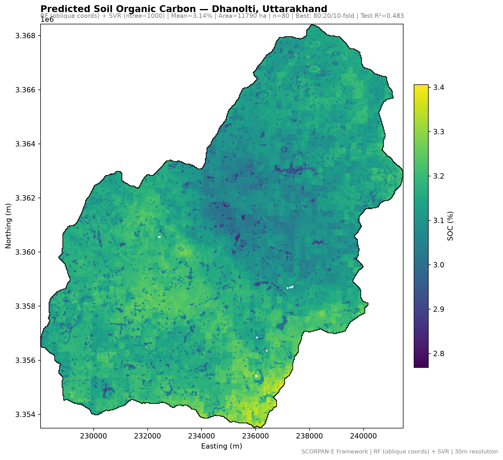

<div align="center">

# 🏔️ Soil Organic Carbon Mapping — Dhanolti, Uttarakhand

**How much organic carbon do the topsoils of a Himalayan watershed hold, and where?**
Digital soil mapping at 30 m with Random Forest on 27 Earth Engine covariates, structured on the SCORPAN-E framework. The original R pipeline now has a validated Python port and an improved RF + SVR model.

[](output/SOC_Map.png)
[](SOC_MASTER.R)
[](scripts/soc_master.py)
[](scripts/SOC_Master_Python.ipynb)




</div>

---

## 📊 Key results

Same data, same seed, same train/test rows in R and Python.

| | R `SOC_MASTER.R` | Python, R method | Python, improved blend |
|---|---|---|---|
| Best single-split test R² | 0.438 (80:20, LOOCV) | 0.441 (80:20, 10-fold) | 0.483 (80:20) |
| 80:20 / 70:30 holdout test R² | 0.414 / 0.347 | 0.464 / 0.330 | 0.483 / 0.292 |
| Train R² (80:20 / 70:30) | 0.824 / 0.797 | 0.823 / 0.797 | — |
| **Mean test R², 50 random 80:20 splits** | — | **0.057** | **0.138** |
| **Mean R², random 5-fold CV (×20)** | — | **0.073** | **0.141** |
| Mean R², spatially blocked 5-fold CV (×20) | — | −0.279 | −0.303 |

| | |
|---|---|
| 🗺️ Map (blend) | mean SOC 3.14 %, range 2.77–3.41 %, 11,790 ha at 30 m |
| 🌲 Models | RF with 1,000 trees; blend = mean of RF (predictors + 6 oblique geographic coordinates) and RBF SVR |
| ✂️ Splits / CV | 70:30 and 80:20 · 5-fold, 10-fold, LOOCV |
| 🧭 Framework | SCORPAN-E, 27 covariates, 19–21 kept by RF %IncMSE |

> ⚠️ **Read the 0.44 carefully.** It is one favourable 16-sample test set. Over 50 random splits the same Random Forest averages **R² ≈ 0.06**, and the blend **≈ 0.14**. Feature selection in the original pipeline also sees the test rows, which adds optimism. The repeated-split and CV figures above do not have that leak.

## 🧪 Validation: which number describes the map?

The spatially blocked cross-validation that this README used to list as *pending* is now done ([`scripts/spatial_validation.py`](scripts/spatial_validation.py)). Blocks are k-means clusters of the sample locations.

| Nearest-neighbour distance | P50 | P90 |
|---|---|---|
| Map pixel → nearest sample | 605 m | 1.33 km |
| Random CV test → training sample | 687 m | 1.45 km |
| Spatial-block CV test → training sample | 2.43 km | 4.51 km |

- **Inside this watershed**, map pixels are as close to samples as random-CV test points are, so random CV is the right accuracy estimate for the map (Milà et al. 2022): **R² ≈ 0.07 for RF, ≈ 0.14 for the blend**.
- **Outside it**, with whole regions held out, every model scores **R² < 0**. The covariates do not transfer to unsampled regions, and the coordinate blend transfers worst. Do not apply the model beyond the sampled area.

## 🔍 What it does

- **Covariates from Earth Engine** — terrain, climate, vegetation dynamics, hydrology, lithology, land use and soil properties for every pixel.
- **Feature selection by importance** — Random Forest %IncMSE keeps the predictors that help out of bag.
- **Uncertainty as a map** — the spread across 1,000 trees is exported as its own raster next to the prediction.
- **Zones for decisions** — the continuous map is also classified into five SOC zones.
- **R-faithful Python port** — reproduces R's random-number generator bit for bit, so `set.seed(42)` + `createDataPartition` picks the same train/test rows. Trees follow `randomForest`'s `nodesize` rule, `%IncMSE` is per-tree OOB permutation, and tuning follows caret. On 30 identical splits R and Python agree to 0.995 correlation in test R².
- **Improved model** — RF + oblique coordinates + SVR, picked from ~30 candidates on 100 random splits and confirmed on 100 untouched splits. `FINAL_MODEL = "RF"` reproduces the R method exactly.

<details>
<summary><b>Tried and rejected</b></summary>

Log or square-root SOC, TPI/TRI terrain indices, residual kriging, XGBoost and gradient boosting, Gaussian-process regression, PLS and ridge regression, kNN, and an inner-CV-tuned SVR. None beat the blend on held-out splits. The extra CSV columns (NDMI, BSI, NDVI statistics, CEC, …) lifted an RF + SVR model by about +0.035 R², but they have no rasters, so they cannot be mapped yet.

</details>

## 🛰️ Covariates

| Category | Variables |
|----------|-----------|
| **Terrain** | Slope, TWI, Elevation, Aspect, Plan Curvature, Profile Curvature |
| **Climate** | Mean Annual Temperature, Mean Annual Precipitation, Precipitation Seasonality |
| **Vegetation** | NDVI, EVI, NDWI, SAVI, NDVI Slope, NDVI Intercept, NDVI Max, Monsoon NDVI Slope, Winter NDVI Slope |
| **Hydrology** | Distance to Stream |
| **Land** | Lithology, LULC |
| **Soil Properties** | pH, Sand %, Clay %, Silt %, Nitrogen (g/kg), Bulk Density (kg/dm³) |

## 🚀 Run it yourself

**R** — edit the two lines at the top of `SOC_MASTER.R`, then source it:

```r
PROJECT_DIR <- "path/to/your/project/folder"
CSV_NAME    <- "your_soc_data.csv"   # inside PROJECT_DIR/data/
source("SOC_MASTER.R")
```

**Python** (3.11 or 3.12) — put `data/` at the repository root (same layout as below), then:

```bash
pip install -r scripts/requirements.txt
python scripts/soc_master.py            # full pipeline, ~35 s
python scripts/spatial_validation.py    # random vs spatial-block CV
python scripts/test_r_parity.py         # checks R-identical RNG and splits
```

Or open [`scripts/SOC_Master_Python.ipynb`](scripts/SOC_Master_Python.ipynb) for the step-by-step version with outputs.

<details>
<summary><b>Pipeline, section by section</b></summary>

| § | What it does |
|---|---|
| 1 | Data loading, cleaning, outlier removal, median imputation |
| 2 | Feature selection via RF variable importance (%IncMSE > 0) |
| 3 | RF across 70:30 and 80:20 splits + 5-fold / 10-fold / LOOCV (blend scored on the same rows) |
| 4 | Best model selection; 4b (Python): 50 repeated splits with selection inside each training set |
| 5 | Spatial prediction → SOC map + uncertainty map (SD across trees) |
| 6 | Map visualisation + output export; spatial validation (Python) |

</details>

<details>
<summary><b>Required input layout</b></summary>

```
PROJECT_DIR/            (repository root for the Python scripts)
  data/
    your_soc_data.csv
    rasters/       27 .tif covariate files
    boundary/      .shp study-area boundary
  output/          created by the scripts
```

</details>

<details>
<summary><b>Outputs written to <code>output/</code></b></summary>

| File | Description |
|------|-------------|
| `SOC_Predicted.tif` | SOC prediction raster (30 m) |
| `SOC_Uncertainty.tif` | SD across 1,000 RF trees |
| `SOC_Zones.tif` | Classified SOC zones (5 classes) |
| `SOC_Map.png` / `SOC_Zone_Map.png` / `SOC_Uncertainty_Map.png` | Maps (committed: blend model) |
| `SOC_Map_R.png` | Map from the original R run, for comparison |
| `Plot_Feature_Importance.png` · `Plot_ObsVsPred.png` · `Plot_Model_Comparison.png` | Diagnostics |
| `RF_All_Results.csv` | All split × CV results (R columns + `Blend_*`) |
| `Robust_Eval.csv` | Test R² over 50 repeated splits, RF vs blend |
| `Spatial_Validation.csv` · `Spatial_Validation_Distances.csv` | Random vs spatial-block CV, distance check |
| `SOC_Map_Summary.csv` | Summary statistics |
| `SOC_FinalRF_Model.rds` / `.joblib` | Saved final model (R / Python, not committed) |

</details>

## ⚠️ Limitations

- Accuracy is low: covariates explain about 7 % (RF) to 14 % (blend) of SOC variation at new points inside the watershed, and nothing outside it.
- 80 samples over ~117 km² is sparse. More samples, or rasters for the extra CSV covariates, would help more than another algorithm.
- Sample points and covariate rasters are not in the repository, so the map cannot be regenerated from a fresh clone.

## 👥 Team

Semester 2 project, Indian Institute of Remote Sensing (IIRS-ISRO), Dehradun · M.Sc. Agriculture Analytics (DAU · AAU · IIRS-ISRO)

| Member | Links |
|---|---|
| **Sathwik Ramaka** | [LinkedIn](https://www.linkedin.com/in/sathwikramaka/) · [GitHub](https://github.com/sathwikramaka) |
| **Kadiri Yaswanthi** | [LinkedIn](https://www.linkedin.com/in/kadiri-yaswanthi-9a632b204/) · [GitHub](https://github.com/YASWANTHI2410) |

<sub>MIT licence</sub>
